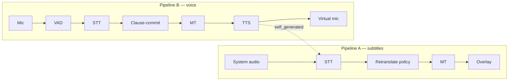

<p align="center">
  
</p>

<p align="center"><strong>Real-time bidirectional speech translation for your desktop.</strong><br/>
Live Persian subtitles for anything your computer plays · your voice, spoken in English into any meeting.</p>

<p align="center">
  <a href="https://github.com/simorgh-app/simorgh/actions/workflows/ci.yml"></a>
  <a href="LICENSE"></a>
  <a href="https://github.com/simorgh-app/simorgh/releases"></a>
  
</p>

---

Simorgh (سیمرغ) runs two pipelines at once:

- **🔊 Listen & subtitle** — captures your system audio (a video, a webinar, a
  meeting), transcribes it as it streams, and shows rolling translated
  subtitles in a translucent always-on-top overlay. Provisional text firms up
  as the sentence completes; finalized lines never change.
- **🎤 Speak & translate** — listens to your microphone, waits for a natural
  pause, translates the clause, and speaks it with TTS into a **virtual
  microphone** you can select in Zoom, Discord, or Meet.

English ↔ Persian ships as the default pair, but every stage is generic — any
language either engine side supports works.

**Local-first.** Whisper, local LLM translation, and Piper TTS run fully
offline. Every stage can also point at an API (OpenAI-compatible, Deepgram,
DeepL, Google, ElevenLabs) — swappable live, per stage. No telemetry, ever.

## Quick start

Download an installer from [Releases](https://github.com/simorgh-app/simorgh/releases)
(MSI/NSIS, DMG, AppImage/deb/rpm), or build from source:

```sh
# Prerequisites: Rust stable, Node 20 + pnpm 9
# Linux: sudo apt install libwebkit2gtk-4.1-dev libgtk-3-dev libasound2-dev \
#          libayatana-appindicator3-dev librsvg2-dev libssl-dev
git clone https://github.com/simorgh-app/simorgh && cd simorgh
pnpm install --dir ui
cargo install tauri-cli --version '^2' --locked
cargo tauri dev      # or: cargo tauri build
```

GPU acceleration for local Whisper: build with `--features cuda` (NVIDIA),
`--features metal` (Apple), or `--features vulkan`. Simorgh falls back to CPU
gracefully if the GPU isn't available.

### First run

A setup wizard walks you through devices, engines, and models — with live
meters that prove audio is flowing before you continue. Audio routing is
automatic on Linux; Windows (VB-Cable) and macOS (BlackHole) get a guided
one-time setup. Details: [docs/audio-routing.md](docs/audio-routing.md).

## Architecture



Every stage is a Rust trait (`SttEngine`, `Translator`, `TtsEngine`,
`CommitPolicy`) — engines are runtime-swappable and adding one is a single
file plus a factory line. See [docs/architecture.md](docs/architecture.md) and
[docs/adding-engines.md](docs/adding-engines.md).

## Engine matrix

| Stage | Local (offline) | API |
|---|---|---|
| Speech-to-text | whisper.cpp (tiny → large-v3, quantized; CUDA/Metal/Vulkan) | OpenAI-compatible · Deepgram (streaming) · custom WS/HTTP |
| Translation | Any OpenAI-compatible server (llama.cpp, Ollama, LM Studio) · NLLB (planned) | OpenAI-compatible · DeepL · Google |
| Text-to-speech | Piper · Kokoro (planned) | OpenAI-compatible · ElevenLabs (streaming) |

All API engines support a custom base URL, keychain-stored keys, and
HTTP/SOCKS5 proxies.

## Why translations “hesitate” — honest latency

English is subject-verb-object; Persian is subject-object-**verb**. A correct
translation often can't start until the clause ends. Simorgh embraces this:
subtitles re-translate as words stream in (provisional text shown dimmed,
finals locked), while spoken output waits for a natural pause — because voice
can't be un-said. The latency badges in the app show real numbers rather than
pretending. Details: [docs/architecture.md](docs/architecture.md).

## FAQ

**Does my audio leave my machine?** Not unless you pick an API engine. The
default local stack is fully offline.

**Can I use language pairs other than English↔Persian?** Yes — set the pair in
Settings; anything your chosen engines support works. RTL rendering is
first-class.

**Why does the spoken translation take ~3 seconds?** Clause-commit policy —
see “honest latency” above.

**Zoom/Discord doesn't show “Simorgh Microphone”.** See
[docs/audio-routing.md](docs/audio-routing.md) for per-OS setup and fixes.

**Will Simorgh transcribe its own voice?** No — TTS output is tagged and gated
out of the subtitle pipeline.

## Roadmap

- [ ] Kokoro TTS (ONNX) and NLLB local translation
- [ ] wait-k / local-agreement commit policies behind `CommitPolicy`
- [ ] STT endpointing signals as commit hints
- [ ] Speaker diarization in subtitles
- [ ] Meeting-app presets and per-app profiles

## Contributing

PRs welcome — see [CONTRIBUTING.md](CONTRIBUTING.md). Good first issues:
adding an engine adapter (one trait + one factory line) or a locale file
(one JSON file).

## License

[Apache-2.0](LICENSE). Third-party license inventory is generated with
`cargo about generate about.hbs > THIRD_PARTY_LICENSES.html` and enforced in
CI by `cargo-deny`.
