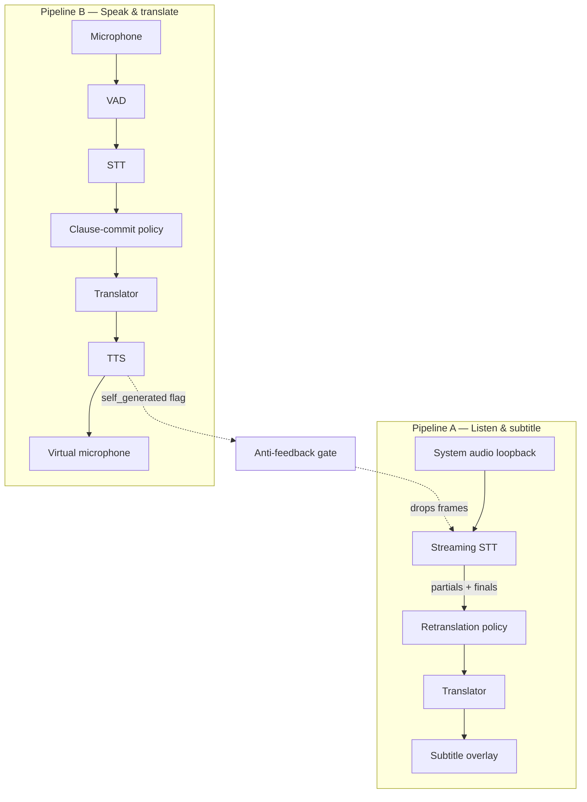

# Architecture

Simorgh is a Cargo workspace with a strict dependency direction: the app crate
depends on engines and audio, which depend only on `simorgh-core`.

## Crates

| Crate | Role |
|---|---|
| `simorgh-core` | Traits (`SttEngine`, `Translator`, `TtsEngine`, `VadEngine`, `CommitPolicy`), pipeline orchestration, config, latency instrumentation, errors |
| `simorgh-audio` | Device enumeration, capture, loopback, virtual microphone, VAD, level meters (cpal) |
| `simorgh-engines-stt` | whisper.cpp (local), OpenAI-compatible, Deepgram (streaming WS), custom WS adapter, mock |
| `simorgh-engines-mt` | OpenAI-compatible (local llama.cpp/Ollama/LM Studio or cloud), DeepL, Google, mock |
| `simorgh-engines-tts` | Piper (local), OpenAI-compatible speech, ElevenLabs (streaming), mock |
| `simorgh` (app) | Tauri v2 shell: IPC commands, windows (dashboard + overlay), hotkeys, model manager, logging |

## Concurrency model

- Everything is `tokio` tasks connected by **bounded** `mpsc` channels
  (`CHANNEL_DEPTH = 32`); backpressure is explicit — audio callbacks use
  `try_send` and drop rather than block the RT thread.
- Each pipeline is independently startable/stoppable; `PipelineHandle::stop`
  aborts all tasks cleanly so engines can be swapped live.
- In-flight translation requests are aborted when superseded by a newer
  partial (retranslation policy) to avoid wasted work and out-of-order UI.

## Commitment policies (why they exist)

English is SVO; Persian is SOV — the verb often arrives at the end of the
Persian clause, so early word-by-word translation is wrong by construction.

- **Subtitles (Pipeline A): retranslation.** Every STT partial re-translates
  the whole open segment (debounced, default 1 s). Provisional text renders at
  reduced opacity and may change; once a segment is final it is **locked and
  never revised**. Target: < 2 s perceived latency.
- **Voice (Pipeline B): clause-commit.** Text is only committed to TTS on a
  VAD-detected pause (default 600 ms) or a forced 6 s window. Spoken audio
  cannot be un-said, so the app is honest about its 2.5–3.5 s budget instead
  of speaking early and wrong.
- Post-v1 policies (wait-k, local agreement LA-2, STT endpointing signals)
  plug in behind the same `CommitPolicy` trait.

## Anti-feedback gate

Every TTS engine flags its output frames `self_generated = true`, and the
voice pipeline raises a global "speaking" flag while synthesizing. The
subtitle pipeline drops gated frames so Simorgh never transcribes its own
voice.

## Config

TOML at the platform config dir (`directories`), hot-reloadable, with named
profiles ("meeting mode", "watching mode") that override the base config.
Secrets are **never** in the TOML — API keys live in the OS keychain under the
`simorgh` service (`keyring` crate).
